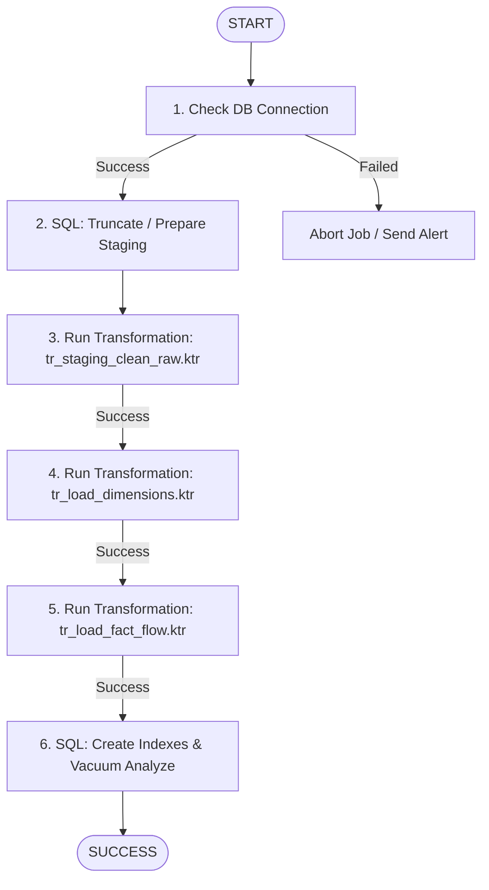

# KẾ HOẠCH TRIỂN KHAI ETL BẰNG PENTAHO DATA INTEGRATION (PDI)

---

## 1. MỤC TIÊU VÀ TỔNG QUAN KIẾN TRÚC

Xây dựng quy trình trích xuất, làm sạch và nạp (ETL) tự động từ 2,540,047 bản ghi mạng thô của dataset UNSW-NB15 vào Kho Dữ Liệu theo mô hình hình sao (Kimball Star Schema) trên nền tảng **Pentaho Data Integration (PDI / Kettle)**.

### Sơ đồ luồng điều phối Master Job (`jb_master_unsw_dw.kjb`)



---

## 2. CHI TIẾT CÁC TRANSFORMATION TRONG PDI

### 2.1 Transformation 1: `tr_staging_clean_raw.ktr` (Làm Sạch & Nạp Staging)

* **Nhiệm vụ**: Đọc 4 tệp CSV thô, khử BOM, chuẩn hóa tên cột, làm sạch cổng Hex, điền khuyết HTTP/FTP, chuẩn hóa chuỗi và ghi vào bảng `stg_network_flow`.
* **Luồng các Step**:
  ```
  [CSV file input] 
         │
         ▼
  [String operations] (Trim khoảng trắng thừa)
         │
         ▼
  [Value mapper] (service '-' -> 'unknown', 'Backdoors' -> 'Backdoor')
         │
         ▼
  [If field value is null] (HTTP/FTP -> 0, attack_cat -> 'Normal')
         │
         ▼
  [Modified JavaScript Value] (Clean Port Hex->Dec, Parse Epoch->Date)
         │
         ▼
  [Select values] (Ép kiểu chuẩn Integer/Float/String)
         │
         ▼
  [Table output] (Ghi khối lớn vào stg_network_flow)
  ```

#### Chi tiết cấu hình Step:
1. **`CSV file input`**:
   * File path: `${PROJECT_HOME}/data/raw/UNSW-NB15_*.csv`
   * Delimiter: `,` | Enclosure: `"` | Header row present: `False`.
   * Khai báo sẵn 49 cột từ `NUSW-NB15_features.csv`.
   * **Cực kỳ quan trọng**: Đặt kiểu dữ liệu của `sport` và `dsport` là `String` (để không bị crash khi gặp Hex).
2. **`String operations`**:
   * Áp dụng `Trim type: both` cho các trường `srcip`, `dstip`, `proto`, `state`, `service`, `attack_cat`, `sport`, `dsport`.
3. **`Value mapper`**:
   * Trường `service`: thay `'-'` thành `'unknown'`.
   * Trường `attack_cat`: thay `'Backdoors'` thành `'Backdoor'`.
4. **`If field value is null`**:
   * `attack_cat` $\rightarrow$ `'Normal'`.
   * `ct_flw_http_mthd` $\rightarrow$ `0`.
   * `is_ftp_login` $\rightarrow$ `0`.
5. **`Modified JavaScript Value`**:
   ```javascript
   function parsePort(p) {
       if (p == null || p == '' || p == '-') return -1;
       var str = trim(p);
       if (str.indexOf('0x') == 0 || str.indexOf('0X') == 0) {
           try {
               var dec = parseInt(str, 16);
               return (dec >= 0 && dec <= 65535) ? dec : -1;
           } catch(e) { return -1; }
       }
       var num = parseInt(str, 10);
       return (!isNaN(num) && num >= 0 && num <= 65535) ? num : -1;
   }

   var clean_sport = parsePort(sport);
   var clean_dsport = parsePort(dsport);

   var start_date = new Date(Number(Stime) * 1000);
   var last_date = new Date(Number(Ltime) * 1000);

   var date_key = Number(date2str(start_date, "yyyyMMdd"));
   var time_key = Number(date2str(start_date, "HHmmss"));
   ```
6. **`Select values`**:
   * Đổi tên `clean_sport` $\rightarrow$ `sport` (`Integer`).
   * Đổi tên `clean_dsport` $\rightarrow$ `dsport` (`Integer`).
   * Đổi tên `ct_src_ ltm` $\rightarrow$ `ct_src_ltm` (`Integer`).
7. **`Table output`**:
   * Target Table: `stg_network_flow` | Commit size: `5000` | Bật **Use batch update for inserts**.

---

### 2.2 Transformation 2: `tr_load_dimensions.ktr` (Nạp Các Bảng Chiều)

* **Nhiệm vụ**: Trích xuất các tập thuộc tính định danh duy nhất từ `stg_network_flow` và nạp vào các bảng Dimension, sinh Surrogate Keys tự động qua Step `Combination lookup/update`.

1. **`Dim_Protocol_Service`**:
   * `Table Input`:
     ```sql
     SELECT DISTINCT proto, service, state FROM stg_network_flow;
     ```
   * `Combination lookup/update`:
     * Target: `dim_protocol_service`
     * Technical key: `proto_service_key` (Sequence/Auto-increment).
     * Dimension fields: `proto`, `service`, `state`.

2. **`Dim_Attack_Classification`**:
   * `Table Input`:
     ```sql
     SELECT DISTINCT attack_cat AS attack_category, label AS is_attack_label 
     FROM stg_network_flow;
     ```
   * `Combination lookup/update`:
     * Target: `dim_attack_classification`
     * Technical key: `attack_key`.
     * Dimension fields: `attack_category`, `is_attack_label`.

3. **`Dim_Host` (Hợp nhất IP Nguồn & Đích)**:
   * `Table Input`:
     ```sql
     SELECT DISTINCT srcip AS ip_address FROM stg_network_flow
     UNION
     SELECT DISTINCT dstip AS ip_address FROM stg_network_flow;
     ```
   * `Formula`: `is_internal = IF(OR(LEFT([ip_address],6)="59.166", LEFT([ip_address],7)="149.171"), TRUE, FALSE)`
   * `Combination lookup/update`:
     * Target: `dim_host`
     * Technical key: `host_key`.

4. **`Dim_Date` & `Dim_Time`**:
   * Sinh sẵn trước bằng script SQL DDL hoặc Step `Generate Rows` + `Add sequence` + `Calculator` để tạo đầy đủ các trường thời gian.

---

### 2.3 Transformation 3: `tr_load_fact_flow.ktr` (Nạp Bảng Fact)

* **Nhiệm vụ**: Đọc dữ liệu từ Staging, thực hiện Lookup lấy các Surrogate Keys từ Dimension, và nạp vào bảng sự kiện `fact_network_flow`.
* **Luồng các Step**:
  ```
  [Table Input: stg_network_flow]
                │
                ▼
  [Database Lookup: dim_protocol_service] (Lấy proto_service_key)
                │
                ▼
  [Database Lookup: dim_attack_classification] (Lấy attack_key)
                │
                ▼
  [Database Lookup: dim_host (Source)] (Lấy source_host_key qua srcip)
                │
                ▼
  [Database Lookup: dim_host (Dest)] (Lấy dest_host_key qua dstip)
                │
                ▼
  [Select values] (Khớp cột và kiểu dữ liệu chuẩn của Fact Table)
                │
                ▼
  [Table output: fact_network_flow] (Ghi batch 10,000 dòng)
  ```

---

## 3. CÁC QUY TẮC TỐI ƯU HIỆU NĂNG TRONG PENTAHO (PERFORMANCE TUNING)

Để xử lý 2.54 triệu dòng với tốc độ cao nhất (dưới 3 phút):
1. **In-Memory Caching cho Database Lookup**:
   * Trong tất cả các step `Database Lookup`, bắt buộc tích chọn **Cache values in memory** và chọn **Cache size = 50,000**.
   * Giúp loại bỏ hoàn toàn hiện tượng thắt cổ chai mạng và I/O đĩa.
2. **Kích thước Batch & Commit**:
   * Trong step `Table output`, đặt **Commit size = 10,000** và bật **Use batch update for inserts**.
3. **Đa luồng (Thread Parallelism)**:
   * Chuột phải vào step `Table output` $\rightarrow$ chọn **Change number of copies to start...** $\rightarrow$ đặt giá trị `2` hoặc `4` để ghi đồng thời nhiều luồng.
4. **Bộ nhớ máy ảo JVM (Kettle Heap Space)**:
   * Chỉnh sửa file `spoon.sh` hoặc `kitchen.sh`:
     ```bash
     PENTAHO_DI_JAVA_OPTIONS="-Xms2048m -Xmx4096m -XX:MaxPermSize=512m"
     ```
