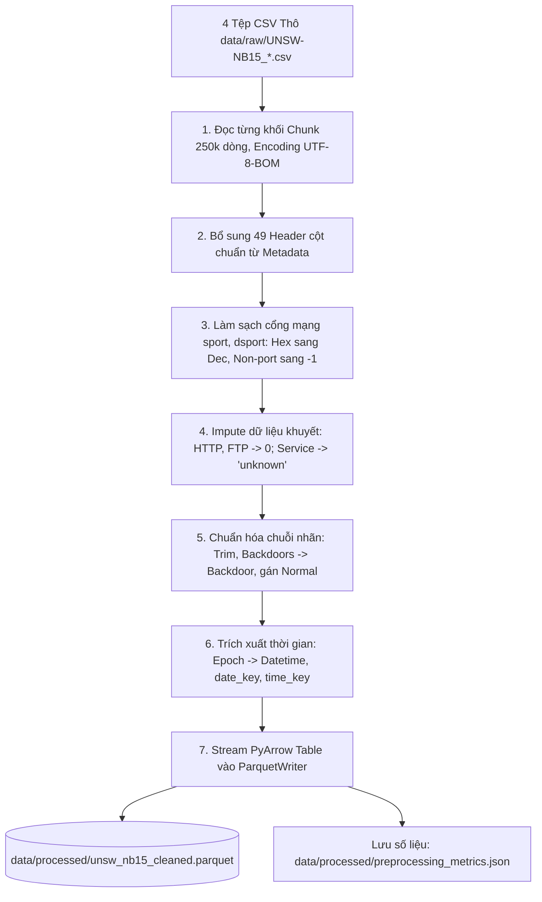

# QUY TRÌNH TIỀN XỬ LÝ DỮ LIỆU (PREPROCESSING PROCESS)

Tài liệu này mô tả chi tiết **quy trình vận hành**, **nguyên lý kỹ thuật** và **các cách chạy** module tiền xử lý dữ liệu [src/preprocessing/cleaner.py](src/preprocessing/cleaner.py) nhằm chuyển hóa 2,540,047 dòng dữ liệu thô thành tập dữ liệu sạch, tối ưu hóa cho Kho Dữ Liệu (Data Warehouse).

---

## 1. TỔNG QUAN KIẾN TRÚC QUY TRÌNH (PROCESS OVERVIEW)

Quy trình tiền xử lý hoạt động theo cơ chế **Streaming Chunk-by-Chunk** kết hợp với **PyArrow ParquetWriter**, đảm bảo:
* **Tối ưu RAM**: Tiêu thụ bộ nhớ cố định (< 250 MB RAM) ngay cả khi xử lý hàng chục triệu dòng.
* **Tốc độ cao**: Xử lý toàn bộ 2.54 triệu dòng trong **~46 giây**.
* **Bảo toàn lược đồ (Schema Integrity)**: Định hình chính xác kiểu dữ liệu cho từng cột, ngăn chặn triệt để lỗi chuyển đổi khi nạp vào cơ sở dữ liệu.



---

## 2. CHI TIẾT CÁC BƯỚC TIỀN XỬ LÝ (STEP-BY-STEP LOGIC)

### Bước 1: Khử BOM & Bổ sung Header cột
* **Vấn đề**: Cả 4 file CSV thô không có dòng tiêu đề; file 1 có ký tự UTF-8 BOM (`\xef\xbb\xbf`).
* **Xử lý**: Sử dụng `encoding="utf-8-sig"` trong Pandas để tự động loại bỏ BOM. Nạp danh sách 49 tên trường từ `data/metadata/NUSW-NB15_features.csv` và chuẩn hóa tên cột lỗi chính tả `ct_src_ ltm` thành `ct_src_ltm`.

### Bước 2: Làm sạch cổng mạng (`sport`, `dsport`)
* **Vấn đề**: Tồn tại chuỗi Hexadecimal (`0x000b`, `0xc0a8`), ký tự `'-'`, và giá trị tràn bộ nhớ (`0x20205321`).
* **Hàm thực thi (`clean_port_value`)**:
  1. Nếu giá trị là `'-'`, rỗng hoặc NaN $\rightarrow$ gán `-1` (đại diện cho giao thức không cổng như ICMP, ARP).
  2. Nếu bắt đầu bằng `'0x'` hoặc `'0X'` $\rightarrow$ chuyển đổi từ cơ số 16 (Hex) sang số thập phân (Dec).
  3. Kiểm tra dải hợp lệ: Nếu `0 <= port <= 65535` thì giữ nguyên; nếu vượt quá 65535 thì gán `-1`.
  4. Ép kiểu toàn bộ về `int32`.

### Bước 3: Điền khuyết dữ liệu đếm (Imputation)
* **Vấn đề**: Các file 2, 3, 4 bị xuất dữ liệu rỗng (blank `, ,`) hoặc chứa dấu cách `' '` ở các trường HTTP/FTP.
* **Xử lý**:
  * `ct_flw_http_mthd`: Thay thế `' '` và NaN bằng `0`, ép kiểu `int32`.
  * `is_ftp_login`: Thay thế `' '` và NaN bằng `0`, ép kiểu `int16`.
  * `ct_ftp_cmd`: Thay thế `' '` và NaN bằng `0`, ép kiểu `int32`.
  * `is_sm_ips_ports`: Thay thế `' '` và NaN bằng `0`, ép kiểu `int16`.

### Bước 4: Chuẩn hóa dịch vụ mạng (`service`)
* **Vấn đề**: Gần 50% bản ghi mang giá trị `'-'`.
* **Xử lý**: Thay thế toàn bộ `'-'` và chuỗi rỗng thành `'unknown'`, cắt tỉa khoảng trắng thừa để làm giá trị dimension hợp lệ cho `Dim_Service`.

### Bước 5: Chuẩn hóa nhãn phân loại tấn công (`attack_cat`)
* **Vấn đề**: 87.35% bản ghi bình thường có `attack_cat` là NaN; tồn tại khoảng trắng (`' Fuzzers '`) và bất nhất số nhiều (`'Backdoors'`).
* **Xử lý**:
  * Điền `'Normal'` cho các giá trị NaN/rỗng.
  * Cắt khoảng trắng hai đầu bằng `.str.strip()`.
  * Thay thế `'Backdoors'` $\rightarrow$ `'Backdoor'`.
  * Ràng buộc logic: Nếu `Label == 0` thì bắt buộc `attack_cat == 'Normal'`.

### Bước 6: Phân rã chiều thời gian (Dimensional Feature Extraction)
* **Vấn đề**: `Stime` và `Ltime` lưu dạng số thực Unix Epoch (giây).
* **Xử lý**:
  * Chuyển đổi thành `start_datetime` và `last_datetime` chuẩn `datetime64[ns, UTC]`.
  * Trích xuất khóa ngày: `date_key = start_datetime.strftime('%Y%m%d').astype(int)` (VD: `20150122`).
  * Trích xuất khóa giờ: `time_key = start_datetime.strftime('%H%M%S').astype(int)` (VD: `114937`).

### Bước 7: Ghi đĩa tối ưu (Streaming ParquetWriter)
* Từng chunk sau khi làm sạch được chuyển thành `pyarrow.Table` và ghi nối tiếp vào tệp Parquet duy nhất với thuật toán nén `snappy`.
* Thu thập và lưu lại toàn bộ số liệu thống kê Trước và Sau vào tệp `data/processed/preprocessing_metrics.json`.

---

## 3. CÁC CÁCH CHẠY TIỀN XỬ LÝ (HOW TO RUN PREPROCESSING)

### Cách 1: Chạy toàn bộ 2,540,047 dòng qua Terminal (Khuyến nghị)
Sử dụng môi trường ảo Python đã được cài sẵn đầy đủ thư viện:
```bash
cd /home/thanglm2006/DW
~/venv/bin/python -m src.preprocessing.cleaner
```
*Thời gian chạy khoảng 40 - 50 giây. Kết quả xuất hiện tại `data/processed/unsw_nb15_cleaned.parquet`.*

### Cách 2: Chạy thử nghiệm trên mẫu (Sample Test Mode)
Nếu muốn chạy thử nhanh trên một số lượng dòng giới hạn (ví dụ: 50,000 dòng):
```bash
~/venv/bin/python -c "
from src.preprocessing.cleaner import UNSWDataCleaner
cleaner = UNSWDataCleaner()
cleaner.process_files(
    raw_pattern='data/raw/UNSW-NB15_1.csv',
    output_parquet='data/processed/sample_cleaned.parquet',
    sample_limit=50000
)
"
```

### Cách 3: Chạy Unit Tests kiểm định chất lượng làm sạch
Để kiểm tra tính toàn vẹn và độ chính xác của các thuật toán làm sạch:
```bash
~/venv/bin/python -m unittest tests/test_preprocessing.py
```
*Kết quả hiển thị `OK` xác nhận tất cả các trường hợp Hex, hyphen, overflow, missing đều được xử lý đúng.*

---

## 4. HƯỚNG DẪN TRỰC QUAN HÓA DỮ LIỆU (DATA PLOTTING)

Dự án cung cấp module chuyên biệt [src/preprocessing/plotter.py](src/preprocessing/plotter.py) để sinh các biểu đồ trực quan hóa dữ liệu trước/sau xử lý và phân tích dữ liệu sạch.

### Chạy sinh toàn bộ biểu đồ:
```bash
~/venv/bin/python -m src.preprocessing.plotter
```

Các biểu đồ được tạo ra:
1. **`docs/before_after_preprocessing.png`**: So sánh 4 nhóm chỉ số Trước vs Sau tiền xử lý (Dữ liệu thiếu, Cổng mạng lỗi, Nhãn tấn công, Tối ưu dung lượng đĩa).
2. **`docs/cleaned_data_overview.png`**: Trực quan hóa đặc tính tập dữ liệu sạch (Phân bố 10 nhóm tấn công, Tỷ lệ giao thức/dịch vụ, Lưu lượng theo giờ).

---

## 5. BÁO CÁO KẾT QUẢ THỰC THI THỰC TẾ

| Tiêu Chí Đo Lường | Dữ Liệu Thô Ban Đầu | Dữ Liệu Sạch Đầu Ra |
| :--- | :--- | :--- |
| **Tổng số bản ghi** | 2,540,047 dòng | 2,540,047 dòng (Bảo toàn 100%) |
| **Dung lượng lưu trữ** | 586.4 MB (4 file CSV) | **192.98 MB** (1 file Parquet nén) $\rightarrow$ Giảm **67.1%** |
| **Cột bị ô nhiễm kiểu** | 312 lỗi Hex / Hyphen / Overflow | **0 lỗi** (100% cổng mạng là số nguyên) |
| **Bản ghi thiếu HTTP/FTP** | 1,429,879 dòng trống | **0 dòng trống** (Đã impute 0) |
| **Bản ghi thiếu Service** | 1,246,397 dòng `'-'` | **0 dòng `'-'`** (Chuẩn hóa thành `'unknown'`) |
| **Biến thể nhãn tấn công** | 13 biến thể bẩn | **10 nhóm quy chuẩn** |
| **Thời gian thực thi pipeline** | - | **46.8 giây** |
